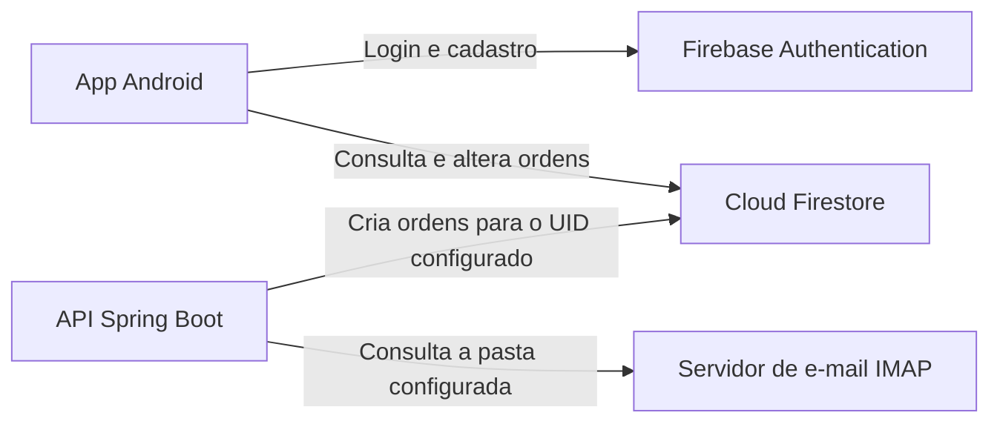

# PIMobileS4

O PIMobileS4 é um aplicativo Android para acompanhar ordens de serviço. Você pode criar uma ordem pelo app ou recebê-la por e-mail usando a API Spring Boot. As duas formas gravam no mesmo Cloud Firestore. Cada conta vê suas próprias ordens e seu histórico.

## Como o sistema funciona



O app usa Java, layouts XML e componentes Material 3. A API em `api-email` roda como um serviço separado e pode ser executada sem o Android Studio. O UID é o identificador da conta no Firebase Authentication. As ordens ficam em `usuarios/{uid}/ordens`, e o histórico fica em `usuarios/{uid}/registros`. A numeração das ordens é sequencial por conta e compartilhada entre o app e a API.

## Casos de uso

| Ator | Caso de uso | Como funciona |
| --- | --- | --- |
| Visitante | Criar conta | Em **Criar conta**, informe o e-mail, escolha uma senha e confirme. Após o cadastro, o app abre a visão geral. |
| Usuário cadastrado | Entrar | Informe e-mail e senha. Com credenciais válidas, o app abre **Visão geral**, com o total de ordens e a contagem por status. |
| Usuário cadastrado | Recuperar senha | Em **Esqueci minha senha**, informe o e-mail para solicitar o link de redefinição. |
| Usuário autenticado | Criar uma ordem | Abra **Nova ordem** em **Início** ou **Ordens**, preencha título, nome do cliente e descrição e salve. A ordem recebe um número e começa com status **Aberta**. |
| Usuário autenticado | Encontrar e consultar uma ordem | Na aba **Ordens**, busque por número, título ou cliente ou filtre por status. Expanda o cartão para ver os dados de contato e a descrição ou abra os detalhes completos. |
| Usuário autenticado | Editar uma ordem | Abra **Editar** na lista ou nos detalhes, altere os campos e salve. O número e a data de criação são preservados. |
| Usuário autenticado | Alterar o status | Nos detalhes, selecione **Alterar status**, escolha o novo status e confirme. A alteração aparece no histórico. |
| Usuário autenticado | Excluir uma ordem | Escolha **Excluir** na lista ou nos detalhes e confirme. A ordem sai da lista e o histórico registra a exclusão. |
| Usuário autenticado | Consultar o histórico | A aba **Registros** mostra criações, edições, mudanças de status e exclusões, com as ações mais recentes primeiro. |
| Usuário autenticado | Exportar PDF | Nos detalhes, gere o PDF da ordem. Em **Relatórios**, exporte a contagem geral por status ou só a do status selecionado. |
| Usuário autenticado | Ajustar a interface ou sair | Em **Perfil**, consulte a conta conectada, acesse as preferências de texto ampliado e alto contraste ou encerre a sessão. As preferências também ficam no cabeçalho. |
| Serviço de importação | Criar uma ordem a partir de e-mail | A API consulta a pasta IMAP por agendamento ou por um POST autenticado. Usa o assunto como título, o remetente como cliente e o corpo como descrição. Grava a ordem e o registro de criação para a conta configurada. |

Telefone, e-mail do cliente e responsável são opcionais no formulário. **Média** é a prioridade inicial, e pode ser alterada antes de salvar. Ordens importadas por e-mail começam com prioridade **Média**. Os status disponíveis são **Aberta**, **Em andamento**, **Concluída** e **Cancelada**. Os modelos de produto e estoque estão no código como base para evolução. O app ainda não oferece telas de estoque ou baixa automática de itens.

## Rodar o aplicativo Android

1. Clone o repositório e abra a pasta `PIMobileS4` no Android Studio.
2. Configure o Gradle para usar um JDK 17 e instale o Android SDK 36. O código do app usa Java 11 como nível de compilação. O aparelho ou emulador precisa ter Android 7.0 (API 24) ou superior.
3. No Console do Firebase, registre o pacote `com.example.pimobiles4` e coloque o `google-services.json` em `app/`.
4. Habilite **E-mail/senha** no Firebase Authentication. Crie o banco padrão do Cloud Firestore e publique as regras de [firestore.rules](firestore.rules).
5. Sincronize o Gradle e rode o módulo `app`. Crie uma conta pelo aplicativo ou entre com uma conta existente do mesmo projeto Firebase.

A compilação pode gerar um APK sem o `google-services.json`, mas o login e o acesso às ordens dependem da configuração do Firebase.

### Demonstrar o rascunho por foto

Salve na galeria do emulador um print com um pedido fictício. Em **Nova ordem → Criar rascunho de uma foto**, selecione o print e confira os campos sugeridos antes de salvar. Use um exemplo como este:

```text
Assunto: Falha no Wi-Fi
Cliente: Ana Demonstração
Descrição: A conexão cai na recepção durante a manhã.
```

## Rodar a API de e-mail

Siga o [guia da API](api-email/README.md) para configurar o projeto Firebase, o UID da conta, as credenciais do servidor, a caixa IMAP e o token do endpoint. Se usar um JSON de conta de serviço para rodar a API localmente, guarde-o fora do repositório. O `google-services.json` configura o Android, enquanto a conta de serviço autoriza a API a gravar no Firestore.

Na raiz do repositório, rode no PowerShell:

```powershell
.\gradlew.bat -p api-email bootRun
```

Por padrão, a API escuta em `127.0.0.1:8080` e consulta a caixa a cada minuto. Para acionar a importação manualmente, use `POST /api/importacoes/email` com o token Bearer. Na primeira importação, as mensagens que já estiverem na pasta configurada também entram na fila. Para conferir o fluxo, envie uma mensagem de teste a essa pasta e procure a ordem no Android com a conta do UID configurado.

Para empacotar a API em um contêiner, use o [guia de execução com Docker](api-email/README.md#rodar-com-docker).

## Estrutura do repositório

| Local | Conteúdo |
| --- | --- |
| `app/src/main/java` | Telas, modelos de dados, acesso ao Firebase e geração de PDF |
| `app/src/main/res` | Layouts, textos, ícones e estilos do Android |
| `app/src/test` | Testes unitários do Android |
| `api-email/` | Projeto Gradle independente com a API Spring Boot e seus testes |
| `Dockerfile` | Imagem da API Spring Boot com Java 17 |
| `firestore.rules` | Regras de acesso do aplicativo ao Firestore |
| `.github/workflows/android-ci.yml` | Validação Android, publicação do APK e tag de versão |

## Validação e versões

Para habilitar a validação antes de cada commit, rode uma vez por clone:

```sh
git config --local core.hooksPath .githooks
```

O gancho valida o conteúdo do índice do Git, ou seja, a versão que entraria no commit. Ele verifica o diff preparado e executa `lintDebug` e `testDebugUnitTest`. Para rodar as verificações e gerar o APK localmente no PowerShell:

```powershell
.\gradlew.bat :app:lintDebug :app:testDebugUnitTest :app:assembleDebug
.\gradlew.bat -p api-email test
```

Nos PRs e pushes para `main`, o GitHub Actions roda o lint, os testes unitários e o build do Android. Nos pushes para `main`, disponibiliza o APK de depuração em **Actions → Validacao Android → Artifacts** e publica uma tag com a mesma versão exibida no APK.

A série começa em `2.0.0`. Depois disso, o workflow usa a última tag `2.x.y` presente no histórico do commit. Se houver um commit `feat:` ou `feat(escopo):`, ou um merge de PR de uma branch `feature/` ou `feat/`, aumenta a versão minor e zera o patch. Por exemplo, `2.1.3` vira `2.2.0`. Os demais casos incrementam o patch, como `2.1.3` para `2.1.4`. Um commit já tagueado mantém sua versão ao repetir o workflow.

O código de versão do APK é o número da execução mais um. Para que o APK acesse o Firebase, configure o secret `GOOGLE_SERVICES_JSON` com o conteúdo do arquivo do Android. O workflow lê esse secret nos builds de `main`.

O job **Validar Docker** executa os testes da API Spring Boot durante o build da imagem, inicia o contêiner com credenciais fictícias e verifica se `GET /status` responde. A validação desativa o agendamento e não consulta o IMAP nem grava no Firestore.
